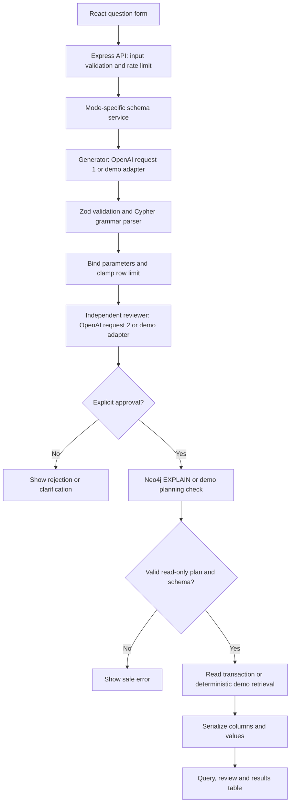

# GraphQuery — report and viva notes

## Problem statement and objectives

Graph databases express connected data naturally, but accessing them usually requires knowledge of Cypher syntax and the database schema. GraphQuery targets e-commerce catalog search by price, ratings, reviews, stock availability and features. It lets a user ask an English question, inspect a generated query, and retrieve results only after independent review and backend checks.

The objectives are to translate natural language using a trusted schema, make the translation inspectable, separate semantic review from technical safeguards, and demonstrate the complete workflow without requiring external credentials.

## Architecture

The browser submits only `{ question }`. It cannot invoke the database or bypass the reviewer. All credentials, prompts, schema loading, checks and orchestration are server-side. Demo and live modes implement the same Generator, Reviewer and Database interfaces. Switching modes changes adapters, not the frontend or workflow.

## Request flow in words

After input validation, the generator sees the English question, trusted schema and supported operations. Structured Outputs supplies a predictable JSON shape. Zod verifies that shape. The parser checks the whole query against a small grammar, verifies schema identifiers and parameter types, and caps the dedicated LIMIT parameter. This candidate is frozen before the independent reviewer sees it.

The reviewer receives a fresh request, not the generator's conversation or explanation. Only approval without outstanding issues proceeds. EXPLAIN plans the exact query and parameters; unknown-schema warnings and planning errors stop execution. A read transaction executes the same candidate. Results are serialized for JSON and displayed directly. At every failed gate, later stages do not run.

## Why two OpenAI calls?

Generation and review have different jobs. Generation proposes a translation. Review separately compares that exact translation with the user's intent, including direction, aggregation, ordering, parameter values and limits. Keeping the requests separate avoids treating the generator's explanation as evidence. The same key/model can be used, but each role has its own prompt and configurable model. This is independent context, not mathematical independence: both calls can share model biases and both can be wrong. There is no guaranteed accuracy improvement, automatic correction loop or third summarization call.

## Three different checks

| Check | What it establishes | What it does not establish |
| --- | --- | --- |
| Grammar and parameter validation | Query belongs to the supported read-only syntax, references known identifiers, and binds valid values/limits | That it answers the intended question or is cheap to run |
| AI review | A second model assessment of intended meaning | Guaranteed correctness or security |
| Neo4j EXPLAIN | Database can parse and plan the query; warnings checked | Correct interpretation of English or existence of matching records |

Database read-only authorization is another independent requirement. Driver read routing alone does not prevent writes under all configurations. A result row limit also does not cap intermediate traversal/aggregation work, so transactions have timeouts.

## Module responsibilities

- Configuration selects mode and validates settings.
- Schema service loads a trusted file and validates labels, property types and directed patterns.
- Generation service makes the first structured model request.
- Safety service tokenizes and parses an intentionally narrow Cypher language.
- Review service makes the second, fresh structured request.
- Workflow service owns ordering and early stopping.
- Neo4j service owns connections, EXPLAIN, read transactions, serialization and closure.
- Demo services derive consistent answers from fictional fixtures without external calls.
- API service handles English input, rate limits and safe errors.
- React interface presents query evidence and dynamic table columns.

## Five-minute demonstration

1. **0:00–0:45:** Start `npm run dev`. Explain the Demo Mode badge and fictional product catalog and INR prices. Say explicitly that no AI/database services are called in this mode.
2. **0:45–1:40:** Choose “Find in-stock headphones under INR 5000 with a rating of at least 4.” Submit, expand parameters, and explain price, rating and availability filters. Show the two matching products.
3. **1:40–2:30:** Choose the noise-cancellation example. Explain the Product → Category and Product → Feature relationships. Show the review verdict and direct results.
4. **2:30–3:20:** Show verified reviews for SoundWave Pro and explain the difference between review excerpts and catalog rating summaries. Then search for headphones under INR 500 to demonstrate an honest empty result.
5. **3:20–4:10:** Show “best product for me” clarification and the intentional rejection case. Explain that neither reaches retrieval. A question outside the fixtures is unsupported.
6. **4:10–5:00:** Show the architecture and `.env.example`. Explain the two live OpenAI requests, exact-candidate review, EXPLAIN, read-only authorization and testing boundaries. Run `npm test` if time allows.

## Likely viva questions

**Why use a graph database?** Relationships between products, categories, features and reviews are first-class graph edges. Pattern matching can traverse them directly.

**Why use parameters?** Values stay separate from query structure, reducing injection risk and preventing ad hoc string concatenation. This implementation also validates parameter types.

**Is Structured Outputs enough for safety?** No. It controls JSON shape, not the validity, security or semantics of the enclosed query.

**Why write a small parser?** A grammar allowlist can reject everything outside the operations this first version understands. A keyword blacklist is easy to evade and cannot establish complete query structure.

**Why not support all Cypher?** A narrow, teachable subset is easier to constrain and test. Unsupported questions are preferable to unsafe guesses.

**Why store schema separately?** The database domain was not supplied initially. A validated configuration file permits later schema changes without changing UI or business logic.

**Why can integers become strings?** Neo4j supports integers outside JavaScript's exact numeric range. Decimal strings preserve those values without precision loss.

**What has actually been tested?** Local demo behavior, API and safety logic, build/type checks, and mocked integration behavior. Actual OpenAI and Neo4j live operation still require the later credentials and schema.

## Limitations and future improvements

- Natural-language ambiguity, hallucinations and shared model biases remain possible; review is fallible.
- The explicit schema can become stale; EXPLAIN warnings help detect some mismatches, not all.
- Demo mode supports fixed examples, not arbitrary language understanding.
- Scalar schema types and the supported grammar exclude many useful Cypher operations.
- Two model calls add latency and API cost; no measured benchmark or accuracy percentage is claimed.
- LIMIT does not bound intermediate query cost, and row values can still be large.
- There is no public-hosting security layer, authentication, persistent history or multi-user permissions.
- Future work could add an evaluated question/query dataset, richer type support, formally parsed Cypher ASTs, query cost policies, schema introspection reviewed by an administrator, export, graph visualization and authentication. These are future ideas, not implemented features.
